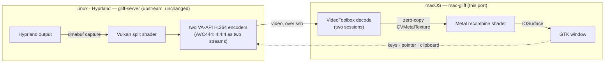

<div align="center">

# mac-gliff

**Remote desktop for [Hyprland](https://hyprland.org) — from your Mac.**<br>
Text stays sharp. All it needs between the two machines is ssh.

[](https://github.com/teomurgi/mac-gliff/actions/workflows/ci.yml)
[](https://github.com/omacom/gliff)
[](LICENSE)

mac-gliff is a macOS port of **[gliff](https://github.com/omacom/gliff)** by Kevin
McConnell: the Linux client's VA-API + Vulkan GPU tier, rebuilt on **VideoToolbox +
Metal**. The server is untouched — it stays on the Linux machine.

</div>

## Why

Most remote desktops send video with halved colour resolution (4:2:0), which is why
coloured text — syntax highlighting, diffs, your terminal — arrives smeared. gliff sends
full-resolution colour (**4:4:4**) by splitting every frame into two H.264 streams
(AVC444) that ordinary hardware encoders can handle, and stitching them back together on
the client.

On Linux, that stitch is a Vulkan compute shader over VA-API decoders. mac-gliff rebuilds
it natively for the Mac:

- **VideoToolbox H.264 decode** — one hardware session per stream; virtual machines fall
  back to software decode automatically.
- **Metal compute recombine** — the shader as MSL, fed straight from the decoder
  through `CVMetalTextureCache`: no pixel copies, no CPU involvement.
- **Zero-copy display** — the recombine writes into an IOSurface the GTK window binds
  directly (`CGLTexImageIOSurface2D`). Decoded frame to screen, untouched.
- **Your keyboard, your layout** — the active macOS layout is detected and mapped to its
  xkb counterpart; 38 pre-generated keymaps ship in the binary, and layout changes are
  picked up mid-session.
- **A CPU tier as fallback** — OpenH264 end to end when no GPU is available; `--video cpu`
  forces it.

Everything else is gliff, unchanged: one connection per machine in a tabbed window, a
shared clipboard in both directions (text, images, files), quality that adapts to the
link, and reconnection when it drops.

## How it works



The protocol runs over `ssh -T host gliff-server --stdio` — no open ports, no accounts,
no relay. Only coded H.264 crosses the network.

## Requirements

| Side | Needs |
|---|---|
| **Your Mac** | [Rust](https://rustup.rs) via rustup (version pinned by `rust-toolchain.toml`) and the GTK 4 libraries: `brew install pkg-config gtk4 libadwaita` |
| **Remote machine** | Linux with [Hyprland](https://hyprland.org) running, [gliff](https://github.com/omacom/gliff) installed, and ssh access from the Mac |

## Build

```sh
git clone https://github.com/teomurgi/mac-gliff && cd mac-gliff
brew install pkg-config gtk4 libadwaita
bin/build -p gliff                       # the client; the server crates build on Linux
./target/release/mac-gliff user@host
```

### As a Mac app

`macos/build-dmg.sh` bundles the client with the whole GTK stack inside
`mac-gliff.app` (libraries relocated, nothing else to install) and wraps it in a
DMG with an `/Applications` symlink:

```sh
macos/build-dmg.sh          # -> dist/mac-gliff-<version>-<arch>.dmg
```

CI builds the same DMG on every push — grab it from the
[Actions artifacts](https://github.com/teomurgi/mac-gliff/actions/workflows/ci.yml).
It is ad-hoc signed only, so Gatekeeper asks on the first launch of a
downloaded copy. No Homebrew formula yet.

On the Hyprland machine, install `gliff-server` from upstream — `omarchy pkg add gliff`
from the [Omarchy Package Repository](https://github.com/omacom/omarchy-pkgs), or [build
it from source](https://github.com/omacom/gliff#install) — or build it from this
checkout; the vendored server crates are unchanged from upstream.

## Use

```sh
mac-gliff user@host                  # mirror the remote screen that has focus
mac-gliff --output DP-1 user@host    # mirror a named remote screen
mac-gliff --headless user@host       # a private remote screen, sized to this window
mac-gliff --video cpu user@host      # force the software tier
```

While the pointer is over the picture, keys and window-manager shortcuts go to the remote
machine; `Shift+Esc` hands them back (`--release-hotkey` changes or disables that). Copy
on one machine, paste on the other.

The Mac's own shortcuts work while the keyboard is local — ⌘Q quits, ⌘W closes the
shown tab, ⌘T/⌘N open the address bar for a new connection. Captured, those chords go
to the remote machine like any other: release first (`Shift+Esc`) to use them locally.

A few chords macOS never hands to any app — Spotlight's ⌘Space, the ⌘Tab app
switcher, Mission Control — so they reach the Mac only, captured or not. GTK's
macOS backend drops ⌥Space too (the non-breaking space it types never becomes a
key event). The launcher is bridged around all that: while captured, ⌃Space is
translated to the remote's `super+space` (`--launcher-hotkey` changes the local
chord, `none` disables it). Or free ⌘Space itself — System Settings → Keyboard →
Keyboard Shortcuts → Spotlight, off or remap "Show Spotlight search" — and it
arrives like any other key.

## Status

Ported and tested: decode + recombine (VideoToolbox + Metal, output checked against the
CPU reference), automatic tier selection in the client, zero-copy display (framebuffer
verified against the decoded pixels), keyboard input for the common layouts, and the
clipboard (verified live, both directions). The DMG bundle launches standalone —
verified from the mounted image, GTK stack and all.

- [x] DMG bundle with the app icon (`macos/build-dmg.sh`; CI publishes the artifact)
- [ ] Homebrew packaging
- [ ] Developer ID codesigning + notarization (the DMG is ad-hoc signed today)

Known limits: exotic keyboard layouts fall back to `us`, and macOS-reserved
chords — Spotlight's ⌘Space, ⌘Tab, Mission Control — stay on the Mac even while
captured (⌃Space stands in for the remote's launcher).

## Documentation

- **[docs/architecture.md](docs/architecture.md)** — the design, the crates, and the
  measurements (upstream; the macOS tier follows the same shape)
- **[docs/hardware-quirks.md](docs/hardware-quirks.md)** — what each GPU driver and
  compositor does, and what is tested where
- **[docs/development.md](docs/development.md)** — building, running on one machine, and
  the tests

## Contributing

Issues and pull requests welcome — see [CONTRIBUTING.md](CONTRIBUTING.md).

## Credits & license

mac-gliff is a port of [gliff](https://github.com/omacom/gliff) by Kevin McConnell. The
upstream crates are vendored in-tree with small, mechanical macOS arms, so upstream
changes keep rebasing cleanly. Without gliff's protocol and design notes this port would
not exist.

MIT — see [LICENSE](LICENSE). The binaries link OpenH264; see [NOTICE](NOTICE).
